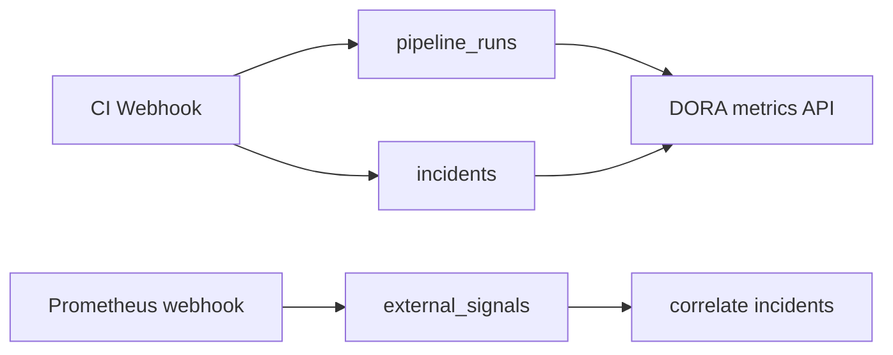

# Runbooks & DORA Metrics (Detailed)



See [Design Schemas & Diagrams](design-diagrams.md) §16, §18.

---

## Runbook templates

### Concept

A **runbook** in SRE Capsule is a **pre-validated workflow document** (DAG JSON) shipped in code (`pkg/integrations/runbooks.go`). Applying a runbook:

1. Loads the template workflow.
2. Validates every action `file_path` against the live plugin registry.
3. Writes `projects.sre_workflow_json` for the target gateway.
4. Sets `enabled: true` so the Visual Workflow Engine owns remediation.

Runbooks do **not** execute shell scripts directly — only native Go integrations.

### Built-in templates

| Template ID | Typical trigger logic | Actions (examples) |
|-------------|----------------------|-------------------|
| `502-restart-pod` | Error contains 502 | K8s rollout + Slack |
| `flaky-triage` | Name prefix `[FLAKY]` | Slack + Jira |
| `perf-regression` | Name prefix `[PERF]` | Datadog + Slack |
| `oom-restart` | OOM / CrashLoop in error | K8s restart |
| `timeout-cache-flush` | Timeout in error | Custom webhook |

Exact graph JSON: `GET /api/runbooks/templates?id=<template_id>`.

### UI workflow (Lead+)

1. Navigate to **Runbooks**.
2. Select **gateway** (project).
3. Preview template description and nodes.
4. Click **Apply** — confirm overwrite of existing workflow.
5. Open **WORKFLOW** on gateway to customize.

### API

```http
GET /api/runbooks/templates
GET /api/runbooks/templates?id=flaky-triage
Authorization: Bearer <jwt>
```

```http
POST /api/runbooks/apply
Authorization: Bearer <jwt>
Content-Type: application/json

{
  "project_id": "1",
  "template_id": "flaky-triage",
  "enable": true
}
```

Requires **Lead**, **Manager**, or **Admin**.

---

## DORA dashboard (Manager)

### Four keys

| Metric | Definition in SRE Capsule |
|--------|-------------------------|
| **Deployment frequency** | `COUNT(pipeline_runs)` / days in range |
| **Lead time for changes** | **Median** minutes from `pipeline_runs.started_at` to first related `incidents.created_at` |
| **Change failure rate** | Runs with `outcome=failure` / total runs |
| **MTTR** | Mean minutes from incident `created_at` to `resolved_at` (resolved only) |

### Recording pipeline runs

Every webhook batch calls `RecordPipelineRun`:

- `project_name`, `pipeline_run_id`, `commit_sha`, `branch`
- `outcome`: `failure` if any incident created in batch, else `success`
- Timestamps for DORA windows

Ensure CI sends stable `X-Run-Id` per pipeline execution.

### UI

**DORA & Executive Dashboard** view:

- Range selector (7d, 30d, …)
- Optional project filter
- Chart series by week (deployments, CFR)
- External signal count + correlated incidents

### API

```http
GET /api/dora/metrics?range=30d&project=
Authorization: Bearer <jwt>
```

Manager role required.

```http
GET /api/dora/signals?project=
```

Lists ingested Prometheus/Alertmanager signals.

---

## Prometheus / Alertmanager webhook

```http
POST /api/webhooks/prometheus?project=my-e2e-suite
X-API-Key: <gateway-api-key>
Content-Type: application/json

{
  "alerts": [
    {
      "labels": { "alertname": "HighErrorRate", "severity": "critical" },
      "annotations": { "summary": "5xx spike on checkout" },
      "startsAt": "2026-05-24T10:00:00Z"
    }
  ]
}
```

Processing:

1. Insert `external_signals` row per alert.
2. Find incidents in same `project_name` with `created_at` within **±15 minutes**.
3. Insert `external_signal_correlations` for matches.

Use case: correlate infra alerts with test failures on the same timeline.

---

## Executive interpretation

| Pattern | Reading |
|---------|---------|
| High CFR + high MTTR | Instability and slow triage — prioritize runbooks + workflow automation |
| High deployment frequency + low lead time | Healthy delivery cadence |
| Many external signals, few correlations | Alerts may not match test gateway project filter |

---

## Error budget and the gateway SLO

Change-failure rate is failed runs divided by all runs. The error budget is how many of those failures the gateway is allowed to spend.

```
allowed = deployments × SLO
burn    = failed / allowed
```

| Burn | Card |
|---|---|
| No runs | Quiet window |
| Under 0.8 | Within budget |
| 0.8 up to 1 | Close to budget |
| 1 or more | Freeze deploys (a warning, not a pipeline block) |

A manager sets the SLO on **DORA**, from **1% to 50%**, and clicks **Save**. The default is 15%.

```http
POST /api/dora/slo
Authorization: Bearer <jwt>
Content-Type: application/json

{ "project": "checkout-api", "slo_percent": 15 }
```

---

## Incident runbook dry-run

**Runbook** on a Telemetry Stream incident plans the matching catalog steps (502, OOM, flaky, timeout, regression) through the plugin engine and stores that plan. The confirmation names the steps. No Slack, Jira, or cluster call is made. A symptom with no matching step is left alone.

Applying a template onto a gateway workflow (the table above) is a different action. It writes the gateway DAG. The incident button does not.

---

## Postmortem

After the incident is resolved, **Write postmortem** drafts from the timeline, comments, and the nearest deploy. If AI is enabled, the model may rewrite that draft and must not add a cause, a person, or a time that is not already in it. If AI is off or does not answer, the factual draft is saved.

---

## Maintenance windows

On **DORA**, under the error budget, a manager starts one window per gateway: reason, and **1 to 24 hours**. Telemetry Stream shows a banner. Incidents that start during the window stay in the list and carry the reason. **End** closes it.

```http
POST /api/maintenance
{ "project": "checkout-api", "reason": "database upgrade", "hours": 4 }

POST /api/maintenance
{ "action": "end", "project": "checkout-api" }
```

Manager or platform admin. The theory map is [SRE theory and SRE Capsule](sre-theory.md).

---

## Related

- [SRE theory and SRE Capsule](sre-theory.md)
- [Platform User Guide](platform-user-guide.md) §8–9
- [System Architecture](architecture.md) — `pipeline_runs`, signals
